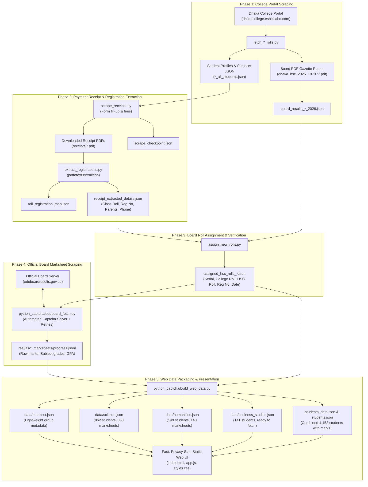

# Dhaka College HSC Result Analysis & Processing System

A comprehensive, modular repository containing data processing pipelines, web dashboards, scrapers, and datasets for analyzing **Dhaka College HSC Examination Results (2026 Batch / Session 2024–2025)** across all three academic divisions: **Science**, **Humanities**, and **Business Studies**.

---

## Architecture & Processing Flowchart



---

## Pipeline Programs & Purpose Reference

| Phase | Program / Script | Academic Group | Primary Purpose | Key Inputs | Key Outputs |
| :--- | :--- | :--- | :--- | :--- | :--- |
| **1** | [`fetch_science_rolls.py`](file:///home/mushfiq/Desktop/DC_Result/hsc%20result%20science/fetch_science_rolls.py) | Science | Scrapes student profile list, photo URLs, and enrolled subject combinations from Dhaka College portal. | College Portal API | `science_students.json` |
| **1** | [`fetch_humanities_rolls.py`](file:///home/mushfiq/Desktop/DC_Result/hsc%20result%20humanities/fetch_humanities_rolls.py) | Humanities | Scrapes all 149 Humanities student profiles and extracts 148 board results from official gazette. | Portal API, `dhaka_hsc_2026_107977.pdf` | `humanities_all_students.json`, `board_results_humanities_2026.json` |
| **1** | [`fetch_business_rolls.py`](file:///home/mushfiq/Desktop/DC_Result/hsc%20result%20business%20studies/fetch_business_rolls.py) | Business Studies | Scrapes all 141 Business Studies student profiles and extracts 134 board results from official gazette. | Portal API, `dhaka_hsc_2026_107977.pdf` | `business_all_students.json`, `board_results_business_2026.json` |
| **2** | [`scrape_receipts.py`](file:///home/mushfiq/Desktop/DC_Result/hsc%20result%20business%20studies/scrape_receipts.py) | All Groups | Authenticates to portal, checks student fee transactions, and downloads official fee/Form fill-up payment PDFs. | `*_all_students.json` | `receipts/*.pdf`, `paid_*_students.json`, `scrape_checkpoint.json` |
| **2** | [`extract_registrations.py`](file:///home/mushfiq/Desktop/DC_Result/hsc%20result%20business%20studies/extract_registrations.py) | All Groups | Uses `pdftotext` to extract SSC/HSC Registration Numbers, parent names, admission rolls, and phone numbers from receipts. | `receipts/*.pdf` | `roll_registration_map.json`, `receipt_extracted_details.json` |
| **3** | [`assign_new_rolls.py`](file:///home/mushfiq/Desktop/DC_Result/hsc%20result%20business%20studies/assign_new_rolls.py) | All Groups | Correlates college class rolls with Dhaka Education Board examination rolls and payment timestamps. | `receipt_extracted_details.json`, `board_results_*_2026.json` | `assigned_hsc_rolls_*.json`, `college_to_hsc_roll_map.json` |
| **4** | [`eduboard_fetch.py`](file:///home/mushfiq/Desktop/DC_Result/python_captcha/eduboard_fetch.py) | All Groups | Automated marksheet fetcher querying `eduboardresults.gov.bd` with computer-vision OCR CAPTCHA solver and exponential backoff. | `assigned_hsc_rolls_*.json` | `results/*/progress.jsonl`, `results/*/marksheets.json` |
| **5** | [`build_web_data.py`](file:///home/mushfiq/Desktop/DC_Result/python_captcha/build_web_data.py) | All Groups | Consolidates marks, computes division and section ranks, generates independent group JSONs, and syncs static web bundle. | `progress.jsonl`, `assigned_hsc_rolls_*.json` | `data/manifest.json`, `data/*.json`, `students_data.json`, `dist/` |

---

## Repository Structure

```
.
├── dhaka_hsc_2026_107977.pdf                 # Official Dhaka Education Board HSC 2026 result gazette
├── hsc result science/                       # Science division pipeline & datasets (862 students)
│   ├── assigned_hsc_rolls_862.json           # Board rolls 108727 – 109579
│   ├── scrape_receipts.py                    # Form fill-up receipt downloader
│   ├── extract_registrations.py              # Registration extractor via pdftotext
│   └── assign_new_rolls.py                   # College roll to HSC board roll mapper
├── hsc result humanities/                    # Humanities division pipeline & datasets (149 students)
│   ├── assigned_hsc_rolls_humanities.json    # Board rolls 254880 – 255026, 900134
│   ├── scrape_receipts.py                    # Form fill-up receipt downloader
│   ├── extract_registrations.py              # Registration extractor
│   └── assign_new_rolls.py                   # Roll correlation engine
├── hsc result business studies/              # Business Studies pipeline & datasets (141 students)
│   ├── assigned_hsc_rolls_business.json      # 132 regular examinees (Board rolls 455282 – 455413)
│   ├── assigned_hsc_rolls_all_141.json       # All 141 students (including 9 Year 1 students)
│   ├── scrape_receipts.py                    # Form fill-up receipt downloader
│   ├── extract_registrations.py              # Registration extractor
│   └── assign_new_rolls.py                   # Roll correlation engine
├── python_captcha/                           # Scraper engine & lightweight static results web app
│   ├── eduboard_fetch.py                     # Official board marksheet scraper with OCR
│   ├── captcha_new.py                        # Multi-pass morphological CAPTCHA solver
│   ├── build_web_data.py                     # Multi-group JSON builder & data packager
│   ├── data/                                 # Lightweight separate JSON endpoints
│   │   ├── manifest.json                     # Cohort metadata, status, student counts (~900 B)
│   │   ├── science.json                      # Science cohort dataset (~1.2 MB)
│   │   ├── humanities.json                   # Humanities cohort dataset (~211 KB)
│   │   └── business_studies.json             # Business Studies cohort dataset (~234 KB)
│   ├── students_data.json                    # Consolidated dataset containing all 1,152 students
│   ├── index.html                            # Responsive dashboard & marksheet viewer
│   ├── app.js                                # Fast client-side router, search, filter, pagination
│   ├── styles.css                            # Professional off-white theme & print stylesheets
│   └── dist/                                 # Ready-to-host production web bundle
└── DCAnalyticsV2/                            # React + Vite analytics platform
```

---

## Execution Guide

### 1. Data Preparation Status by Academic Group

| Division | College Rolls | Total Students | 2nd Year Candidates | Form Fill-Up Paid | Board Exam Rolls | Marksheets Scraped |
| :--- | :--- | :--- | :--- | :--- | :--- | :--- |
| **Science** | `1202425010001` – `1202425010900` | 862 | 862 | 853 | `108727` – `109579` | **850** (640 GPA 5.00) |
| **Humanities** | `1202425030001` – `1202425030155` | 149 | 143 | 142 | `254880` – `255026` | **140** (12 GPA 5.00) |
| **Business Studies** | `1202425020001` – `1202425020146` | 141 | 132 | 132 | `455282` – `455415` | **Ready to Run** |

---

### 2. Running Business Studies Marksheet Scraper

All preparation steps (profile scraping, receipt downloading, registration extraction, and HSC roll correlation) are complete.

To run the marksheet fetcher for Business Studies:

```bash
cd /home/mushfiq/Desktop/DC_Result/python_captcha

python3 eduboard_fetch.py \
  --input assigned_hsc_rolls_business.json \
  --out results/business_marksheets \
  --board 10 \
  --year 2026 \
  --min-delay 1.0 \
  --max-delay 2.0
```

> **Resume Support**: If interrupted, simply append `--resume` to continue where it left off:
> ```bash
> python3 eduboard_fetch.py --input assigned_hsc_rolls_business.json --out results/business_marksheets --resume
> ```

---

### 3. Rebuilding Web Data & Dist Package

After scraping finishes (or at any point while scraping is running to preview progress):

```bash
python3 /home/mushfiq/Desktop/DC_Result/python_captcha/build_web_data.py
```

This updates:
- `python_captcha/data/manifest.json`
- `python_captcha/data/science.json`
- `python_captcha/data/humanities.json`
- `python_captcha/data/business_studies.json`
- `python_captcha/students_data.json` & `students.json`
- `python_captcha/dist/` (static build ready for deployment)

---

### 4. Hosting & Running Locally

To preview the dashboard locally:

```bash
cd /home/mushfiq/Desktop/DC_Result/python_captcha
python3 -m http.server 8000
```
Open **`http://localhost:8000`** in any browser.

#### Static Hosting Options
The contents of `python_captcha/dist/` (or `python_captcha/`) can be deployed to:
- **Cloudflare Pages**: Drag and drop the `dist/` folder or link to GitHub.
- **GitHub Pages**: Set repository Pages source to `dist/` (or root).
- **Vercel / Netlify**: Deploy as a static directory without any build command.
- **Any Apache/Nginx Web Server**: Simply copy the files into your web root.
